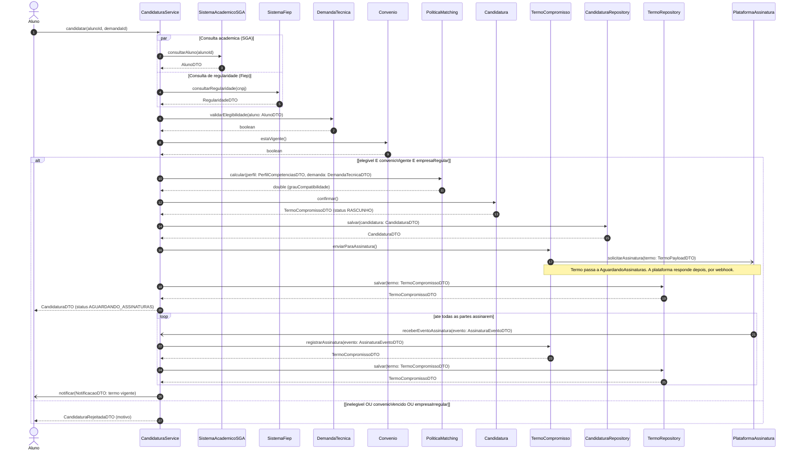
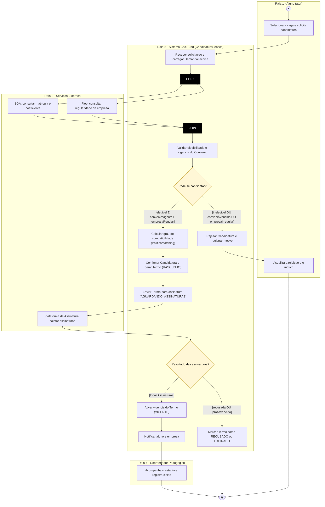
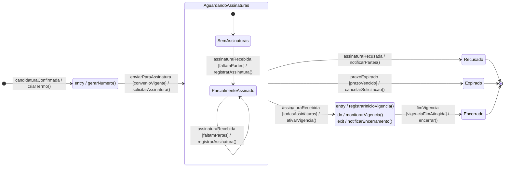
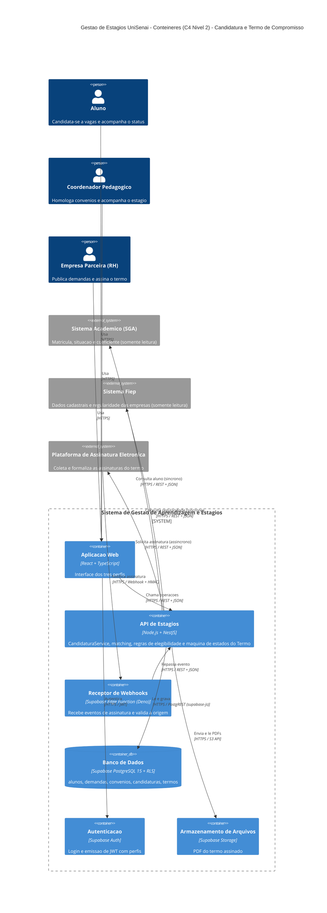

# APS 3 — Dossiê de Arquitetura Viva

**Unidade Curricular:** Modelagem de Software — Engenharia de Software (4º período, UniSenai)
**Projeto da equipe:** Sistema de Gestão de Aprendizagem e Estágios da UniSenai (Grupo 6)
**Autor:** _Nome Sobrenome_ (trabalho individual)

## 1. Funcionalidade crítica modelada

**Candidatura → Termo de Compromisso → Assinatura Eletrônica** (RF04 e RF05 do backlog da Sprint 2).

O aluno solicita candidatura a uma demanda técnica. O sistema consulta o SGA (situação acadêmica) e o Sistema Fiep (regularidade da empresa) em paralelo, valida a elegibilidade e a vigência do convênio e calcula a compatibilidade. Estando tudo regular, confirma a candidatura, gera o `TermoCompromisso` e o envia para a Plataforma de Assinatura Eletrônica. A plataforma responde de forma assíncrona (webhook), uma vez por parte signatária. Quando todas assinam, o termo se torna vigente.

**Por que é crítica:** o termo tem validade jurídica, depende de três integrações externas e não pode ficar em estado inválido (por exemplo, vigente sem todas as assinaturas ou com convênio vencido).

**Entidade da máquina de estados:** `TermoCompromisso`.

## 2. Estrutura do repositório

```
aps3-nome-sobrenome/
├── docs/
│   ├── architecture/
│   │   ├── workspace.mmd      # C4 Nível 2 (Mermaid)
│   │   └── adr-0001.md        # ADR 0001
│   └── diagrams/
│       ├── sequencia.mmd
│       ├── atividades.mmd
│       └── estados.mmd
└── README.md
```

Os blocos abaixo são cópias dos arquivos `.mmd`. A fonte de verdade são os arquivos em `docs/`.

## 3. Artefato 1 — Diagrama de Sequência

Convenções: `->>` é chamada síncrona bloqueante, `-)` é mensagem assíncrona, `-->>` é retorno com DTO. Fragmentos usados: `par` (consultas paralelas), `alt/else` (tratamento de exceção) e `loop` (eventos de assinatura).



### Regra de consistência: mensagem → operação pública

| Linha de vida | Mensagem | Operação pública declarada | Situação |
|---|---|---|---|
| CandidaturaService | `candidatar(alunoId, demandaId)` | `+ candidatar(alunoId, demandaId): CandidaturaDTO` | Nova (camada de serviço) |
| CandidaturaService | `receberEventoAssinatura(evento)` | `+ receberEventoAssinatura(evento: AssinaturaEventoDTO): void` | Nova (endpoint do webhook) |
| SistemaAcademicoSGA | `consultarAluno(alunoId)` | `GET /alunos/{id}`, contrato da API externa | Externa |
| SistemaFiep | `consultarRegularidade(cnpj)` | `GET /empresas/{cnpj}/regularidade`, contrato da API externa | Externa |
| DemandaTecnica | `validarElegibilidade(aluno)` | `+ validarElegibilidade(a: Aluno): boolean` | Existente na Sprint 2 (o parâmetro vira `AlunoDTO`) |
| Convenio | `estaVigente()` | `+ estaVigente(): boolean` | Existente na Sprint 2 |
| PoliticaMatching | `calcular(perfil, demanda)` | `+ calcular(p, d): double` | Existente na Sprint 2 |
| Candidatura | `confirmar()` | `+ confirmar(): TermoCompromisso` | Existente na Sprint 2 |
| TermoCompromisso | `enviarParaAssinatura()` | `+ enviarParaAssinatura(): void` | Existente na Sprint 2 |
| TermoCompromisso | `registrarAssinatura(evento)` | `+ registrarAssinatura(e: AssinaturaEventoDTO): TermoCompromissoDTO` | **Nova: incluir no diagrama de classes** |
| CandidaturaRepository | `salvar(candidatura)` | `+ salvar(c: CandidaturaDTO): CandidaturaDTO` | Nova (interface) |
| TermoRepository | `salvar(termo)` | `+ salvar(t: TermoCompromissoDTO): TermoCompromissoDTO` | Nova (interface) |
| PlataformaAssinatura | `solicitarAssinatura(termo)` | `POST /solicitacoes`, contrato da API externa | Externa |

Os DTOs cruzam as fronteiras entre o domínio e as camadas de serviço e persistência, e entre o sistema e os serviços externos.

## 4. Artefato 2 — Diagrama de Atividades com Raias

São quatro raias: Aluno, Sistema Back-End, Serviços Externos e Coordenador. As decisões têm guardas mutuamente exclusivas. O **Fork/Join** paraleliza as consultas ao SGA e ao Fiep. O Mermaid não tem raias nativas, então as raias são emuladas com `subgraph`, e as barras de Fork e Join são nós pretos.



## 5. Artefato 3 — Diagrama de Transição de Estados (`TermoCompromisso`)

Transições no formato `Gatilho [Guarda] / Ação()`. O estado composto `AguardandoAssinaturas` tem subestados, e `Vigente` tem as ações internas `entry /`, `do /` e `exit /`. Os estados terminais são `Recusado`, `Expirado` e `Encerrado`. Entre `Rascunho` e `Vigente` só se chega passando por `AguardandoAssinaturas`, o que protege o termo contra estados inválidos.



## 6. Artefato 4 — Visão de Contêineres (C4 Nível 2)

Os conectores explicitam tecnologia e protocolo. As chamadas ao SGA e ao Fiep são síncronas, e a assinatura é assíncrona, com retorno por webhook.



## 7. Artefato 5 — ADR 0001

Veja [`docs/architecture/adr-0001.md`](docs/architecture/adr-0001.md): **Adoção do Supabase (PostgreSQL gerenciado com RLS) como camada de dados**.

## 8. Consistência entre os modelos

| Conceito | Sequência | Atividades | Estados |
|---|---|---|---|
| Consulta paralela ao SGA e ao Fiep | `par ... and ... end` | Fork/Join | — |
| Elegibilidade e convênio vigente | `alt [elegivel E convenioVigente E empresaRegular]` | Decisão `Pode se candidatar?` | Guarda `[convenioVigente]` em `enviarParaAssinatura` |
| Envio do termo | `enviarParaAssinatura()` | `Enviar Termo para assinatura` | `Rascunho → AguardandoAssinaturas` |
| Assinatura assíncrona | `-)` + `loop` + `registrarAssinatura()` | `Plataforma de Assinatura: coletar assinaturas` | `assinaturaRecebida [faltamPartes]` |
| Todas as partes assinaram | fim do `loop` | `[todasAssinaturas]` | `→ Vigente / ativarVigencia()` |
| Recusa ou prazo vencido | — (coberto nos estados e nas atividades) | `[recusada OU prazoVencido]` | `Recusado` e `Expirado` |

## 9. Observações e pendências

- **Fiep na candidatura:** a consulta de regularidade no momento da candidatura é uma decisão desta APS. Na Sprint 2 ela aparece como `include` de *Homologar convênio*.
- **Diagrama de classes:** incluir `registrarAssinatura()` em `TermoCompromisso` e as interfaces `CandidaturaRepository` e `TermoRepository`.
- **Estados da `Candidatura`:** `status` é `String` na Sprint 2. Os estados do termo (`RASCUNHO`, `AGUARDANDO_ASSINATURAS`, `VIGENTE`, ...) devem usar exatamente estes nomes no código.
